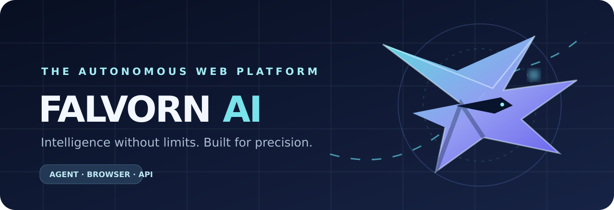
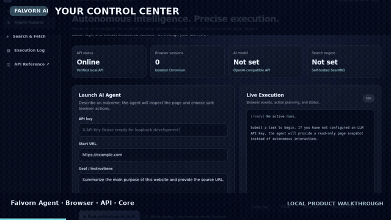

<div align="center">



# FALVORN AI

**The autonomous web execution foundation.**  
*Intelligence without limits. Precision in every action.*

[](https://www.python.org/) [](https://fastapi.tiangolo.com/) [](https://playwright.dev/)  

**[Getting started](#-quick-start)** · **[Architecture](#-architecture)** · **[API](#-api-and-sdk)** · **[Security](#-security-boundaries)** · **[Demo video](assets/demo/falvorn-walkthrough.mp4)** · **[Roadmap](docs/roadmap.md)**

</div>

---

## 🎬 Product walkthrough

<div align="center">
  <a href="assets/demo/falvorn-walkthrough.mp4" title="Open the Falvorn AI walkthrough video">
    
  </a>
  <p><b>▶ <a href="assets/demo/falvorn-walkthrough.mp4">Watch the 41-second Falvorn AI product walkthrough (MP4)</a></b></p>
</div>

> **Demo provenance:** The dashboard in this video is rendered from this repository's real HTML/CSS, and the extraction view uses an actual `POST /v1/fetch` result against a synthetic localhost test page. The planner-event view is **explicitly illustrative**. Administrator restrictions in the recording environment blocked Chromium URL navigation, so the video does **not** claim successful autonomous browsing on a public website. The soundtrack is newly generated for this repository. GitHub reliably renders the preview GIF; MP4 playback is linked separately.

## Why Falvorn?

Falvorn AI is an **independent, self-hostable AI web-agent prototype** built as the foundation of a future web automation platform. It combines model-guided decisions, browser sessions, extraction, search and monitors behind one developer-facing API. It is not a 100% TinyFish replica, not an endorsed TinyFish product, and **not yet certified for production SaaS deployment**.

### Four connected product modules

| Product | What exists today | Code |
|---|---|---|
| **Falvorn Agent** | Bounded goal-oriented loop, optional OpenAI-compatible planner, persisted runs/events, cancellation, event streaming | `falvorn/agent.py`, `falvorn/store.py` |
| **Falvorn Browser** | Local isolated Chromium contexts, guarded navigation/actions, DOM snapshots and authenticated screenshot endpoint | `falvorn/browser.py` |
| **Falvorn API** | REST/OpenAPI, Python SDK/CLI, optional MCP, HTML extraction, SearXNG adapter, monitors, dashboard | `falvorn/api.py`, `falvorn/sdk.py`, `falvorn/mcp_server.py` |
| **Falvorn Core** | Pydantic models, configuration, API-key checks, domain/private-network filters | `falvorn/config.py`, `falvorn/security.py`, `falvorn/models.py` |

## ✨ Architecture

<div align="center">

</div>

The SVG above includes restrained CSS motion, with reduced-motion support. It is a **conceptual map of the current single-process implementation**, not a claim that a distributed worker fleet exists.

See [Architecture & execution sequence](docs/architecture.md), [Threat model](docs/security/threat-model.md) and [Evaluation methodology](docs/benchmarks/evaluation.md).

## ✅ What works — and what doesn't yet

| Capability | v0.2 state | Important qualifier |
|---|---|---|
| HTML/text fetch and clean Markdown | **Implemented** | SSRF checks need network-level hardening |
| Dynamic/JS page extraction | **Implemented adapter** | Requires working Chromium on host |
| Self-hosted search | **Implemented adapter** | Requires configured SearXNG service |
| Agent LLM planning | **Implemented adapter** | Requires compatible LLM endpoint; otherwise snapshot-only |
| Browser sessions/actions | **Implemented locally** | Live external-site success not verified here |
| Browser screenshot | **Implemented** | Session must exist and request must be authorized |
| Run/event persistence | **Implemented — single node** | SQLite WAL; restart marks active jobs `interrupted` |
| Run cancellation/history | **Implemented — single process** | No distributed queue/replay |
| Manual page change monitor | **Implemented** | SQLite content hashes |
| Scheduled interval monitor | **Optional prototype** | Disabled by default; in-process only, no notifications |
| Python SDK / CLI / stdio MCP | **Implemented adapters** | External integration contracts need further testing |
| Private credential vault, hosted browser fleet | **Not implemented** | No unattended logins, browser marketplace or cloud scaling |
| Multi-tenant organizations, billing, public SaaS | **Not implemented** | Do not deploy as a multi-user Internet product |

### 🧪 Validation snapshot

- **14 local tests passed** in the 2026-10-29 development environment (API, extraction, browser in-memory page and screenshots, SQLite recovery/subscriptions, URL policy).
- `POST /v1/fetch` was exercised against a local synthetic HTTP server and returned verified structured content.
- Live browser navigation was **blocked by this environment's browser administration policy**. Real-world website benchmarks and production deployment have **not** been verified.
- Every claimed production feature must pass the [release gates](docs/roadmap.md) and [threat model](docs/security/threat-model.md).

## 🚀 Quick start

### Requirements

Python 3.11+, Chromium/Playwright, and (for autonomous decisions) credentials for an **OpenAI-compatible model endpoint**. For standalone web search, configure SearXNG.

```bash
git clone https://github.com/hossain0707/Falvorn-AI.git
cd Falvorn-AI
python -m venv .venv
source .venv/bin/activate                 # Windows: .venv\\Scripts\\activate
pip install -r requirements.txt
python -m playwright install chromium
cp .env.example .env                      # Windows: copy .env.example .env
# Set FALVORN_API_KEY to a strong value; optionally set LLM_API_KEY and SEARXNG_URL
python -m falvorn
```

Open **http://127.0.0.1:8000** for the developer dashboard, or **http://127.0.0.1:8000/docs** for generated OpenAPI docs. The default bind is loopback. **Do not expose this prototype on a public interface.**

### Docker Compose — local-only prototype

```bash
cp .env.example .env
# Edit .env to set a strong FALVORN_API_KEY and optional model configuration.
# Set an adequate SearXNG secret in deploy/searxng.yml.
docker compose up --build
```

Compose binds the API to `127.0.0.1:8000` and persists local data to a Docker volume. The SearXNG image in this demo uses a floating tag; pin the image digest, review dependency licenses and harden network policy for any controlled deployment. The database and scheduler here are **not** suitable for horizontally scaled workers.

## 🔌 API and SDK

```bash
export FALVORN_API_KEY='your-local-api-key'

# Fetch and parse a page
curl -s http://127.0.0.1:8000/v1/fetch \\
  -H "X-API-Key: $FALVORN_API_KEY" -H 'Content-Type: application/json' \\
  -d '{"url":"https://example.com"}'

# Start a read-only agent task
curl -s http://127.0.0.1:8000/v1/agent/runs \\
  -H "X-API-Key: $FALVORN_API_KEY" -H 'Content-Type: application/json' \\
  -d '{"url":"https://example.com","goal":"Summarize this page with a source URL"}'

# Get persisted run history, status and events
# GET  /v1/agent/runs
# GET  /v1/agent/runs/{id}
# GET  /v1/agent/runs/{id}/events       (SSE)
# POST /v1/agent/runs/{id}/cancel

# Browser (within an authenticated, authorized session)
# POST   /v1/browser/sessions
# POST   /v1/browser/sessions/{sid}/actions
# GET    /v1/browser/sessions/{sid}/screenshot
# DELETE /v1/browser/sessions/{sid}

# Page-change monitoring
# POST /v1/monitor/check
# POST /v1/monitor/subscriptions
# GET  /v1/monitor/subscriptions
```

Python SDK:

```python
from falvorn.sdk import FalvornClient

with FalvornClient(api_key="your-local-api-key") as api:
    page = api.fetch("https://example.com")
    print(page["title"])
    task = api.start_agent("https://example.com", "Summarize this page")
    print(api.get_run(task["run_id"]))
```

Optional MCP adapter (stdio):

```bash
pip install -r requirements-mcp.txt
python -m falvorn.mcp_server
```

For the MCP host set `FALVORN_BASE_URL` and `FALVORN_API_KEY`. Do not expose model or API credentials in screenshots or logs.

## 🛡 Security boundaries

This is a *development foundation*, not a ready-to-sell managed browser platform. It uses one deployment-level API key, in-process browser contexts, and best-effort URL validation. Domain/DNS filters and button-label heuristics **are not adequate protection** against SSRF, DNS rebinding, browser escape, prompt injection, malicious websites or multi-user abuse. Avoid real credentials, private customer data, financial operations or high-stakes websites. See [SECURITY.md](SECURITY.md) and the [detailed threat model](docs/security/threat-model.md).

### Development commands

```bash
python -m pip install -r requirements-dev.txt
python -m playwright install chromium
python -m pytest -q
python -m compileall -q falvorn
```

The demonstration is reproducible with a synthetic local webpage, but `ALLOW_PRIVATE_TARGETS=true` must only be used on a trusted **loopback test setup**; never enable it on public-facing deployments.

## 📚 Development documentation

| Document | Why it matters |
|---|---|
| [Architecture](docs/architecture.md) | Components, sequence diagram, persistence, failure recovery |
| [Roadmap](docs/roadmap.md) | Implemented vs planned with exit criteria |
| [Comparison](PARITY.md) | Honest capability parity and gaps |
| [Security](SECURITY.md) | Disclosure and safety expectations |
| [Threat model](docs/security/threat-model.md) | Trust boundaries and deployment gates |
| [Benchmark methodology](docs/benchmarks/evaluation.md) | Evaluation design without invented scores |
| [Contributing](CONTRIBUTING.md) | Development workflow and change review |
| [Project memory](PROJECT_MEMORY.md) | Cross-chat handover and four module histories |
| [Change log](CHANGELOG.md) | Release-by-release development history |

## © Ownership and license

**Copyright © 2026 Md Najmul Hossain. All rights reserved.** The Falvorn AI original implementation, brand assets and documentation are **proprietary**. Merely viewing a public repository is **not** a grant of open-source or commercial reuse rights. Copying, modification, distribution, hosting or commercial use requires the copyright holder's written authorization, except where applicable law permits. Third-party dependencies keep their own licenses. Read [LICENSE](LICENSE).

---

<div align="center">

**FALVORN AI**  
*Intelligence without limits · Built to earn trust through evidence*

Maintained by **[Md Najmul Hossain](https://github.com/hossain0707)** · [GitHub repository](https://github.com/hossain0707/Falvorn-AI)

</div>
