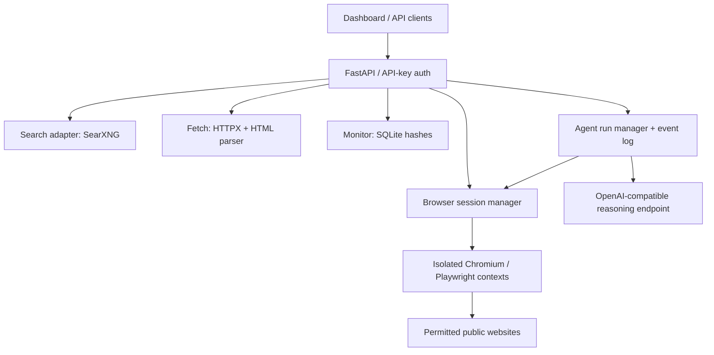

# Falvorn AI

> **Intelligence without limits.** Built for precision, powered by autonomy.

**Falvorn AI** is an independently engineered, self-hostable autonomous browser-agent foundation. Its flagship product is **Falvorn Agent**, with **Falvorn Browser**, **Falvorn API**, and **Falvorn Core** as clearly defined components. This repository implements an experimental modular monolith, *not* four finished commercial services.

| Component | Source | Current capabilities |
|---|---|---|
| **Falvorn Agent** | `falvorn/agent.py` | Goal-driven agent loop with optional model reasoning and run events |
| **Falvorn Browser** | `falvorn/browser.py` | Local isolated Chromium contexts, DOM observation and restricted actions |
| **Falvorn API** | `falvorn/api.py`, `falvorn/sdk.py`, `falvorn/mcp_server.py` | REST endpoints, Python client, optional local MCP adapter |
| **Falvorn Core** | `falvorn/config.py`, `falvorn/models.py`, `falvorn/security.py` | Configuration, request validation and safety policies |

**Project maturity:** v0.1 experimental MVP · not production certified · no production-scale parity claims.

**Project guides:** [Architecture](docs/architecture.md) · [Roadmap](docs/roadmap.md) · [Security](SECURITY.md) · [Contributing](CONTRIBUTING.md) · [Changelog](CHANGELOG.md) · [GitHub setup](REPOSITORY_SETUP.md)

> **Independent, clean-room web automation MVP** — search, fetch, browser interaction, autonomous agent runs, and page-change checks. **Not affiliated with, endorsed by, or using the proprietary implementation of TinyFish.**

   

## Architecture



## Included features (tested or implementable)

| Capability | Current state | Notes |
|---|---|---|
| Search | Implemented adapter | Configure a separate SearXNG service; search quality depends on its engines |
| Fetch | Implemented | HTML/text to clean Markdown; optional JS-rendered fetch |
| Browser | Implemented | Isolated local Chromium sessions, element-index actions; **not remote CDP** |
| Agent | Implemented | Goal-driven planner; requires your OpenAI-compatible API key to act autonomously |
| Monitor | Implemented | Manual content-hash checks stored in SQLite; not scheduled alerts |
| Dashboard | Implemented | Responsive web UI with agent and extraction console |
| API | Implemented | OpenAPI endpoints with API-key header |
| Audit log | MVP | Run-level event logs in memory; no durable audit trail yet |
| Vault | Not implemented | No secure credential management or authenticated-login workflow |
| Python SDK / CLI | Implemented | Lightweight Python client and argparse CLI; not TinyFish API-compatible |
| MCP server | Implemented adapter | Optional local stdio server with five tools; install `requirements-mcp.txt` |
| Cloud/browser proxies | Not implemented | Runs Chromium locally; no managed remote CDP fleet |
| Multi-tenancy / billing | Not implemented | Single deployment, one API key |
| CAPTCHA / anti-bot bypass | Not implemented | Respect website access controls |

This is **not a 100% replica** of TinyFish and is **not production-complete**. It is a functional, independently authored foundation for a competing platform. Public feature descriptions are reference points, not code dependencies.

## Quick start: local Python

```bash
python -m venv .venv
source .venv/bin/activate           # Windows: .venv\\Scripts\\activate
pip install -r requirements.txt
# For machines without system Chromium:
python -m playwright install chromium
cp .env.example .env               # Windows: copy .env.example .env
# Edit .env: FALVORN_API_KEY=... and LLM_API_KEY=... (optional).
# For standalone search, set SEARXNG_URL to your SearXNG instance.
python -m falvorn
```

Open **http://127.0.0.1:8000** for the dashboard, or **http://127.0.0.1:8000/docs** for the Swagger API. `python -m falvorn` binds to loopback by default. If you configure an API key, paste it into the dashboard to authorize requests. Without `LLM_API_KEY`, agent runs return a real page snapshot, not a fake autonomous result. Without `SEARXNG_URL`, search returns 503 (an honest not-configured status).

### Docker Compose (bundled SearXNG)

```bash
cp .env.example .env
# Replace FALVORN_API_KEY with a strong random value.
# Set LLM_API_KEY to enable autonomous agent planning.
# Replace the SearXNG secret key in deploy/searxng.yml.
docker compose up --build
```

The bundled SearXNG container is configured automatically through Compose. The Compose deployment publishes only to **127.0.0.1:8000**. Set up an HTTPS reverse proxy with identity/access controls before using remotely. Do **not** expose the bare demo to the Internet.

## API examples

```bash
export FALVORN_API_KEY='the-secret-configured-in-.env'

# Read a page (server must have network access)
curl -s http://127.0.0.1:8000/v1/fetch \
  -H "X-API-Key: $FALVORN_API_KEY" -H 'Content-Type: application/json' \
  -d '{"url":"https://example.com"}'

# Execute a browser-agent task (requires model key for autonomous actions)
curl -s http://127.0.0.1:8000/v1/agent/runs \
  -H "X-API-Key: $FALVORN_API_KEY" -H 'Content-Type: application/json' \
  -d '{"url":"https://example.com","goal":"Describe the main purpose of the page with evidence"}'

# GET /v1/agent/runs/{run_id}
# GET /v1/agent/runs/{run_id}/events   (server-sent events)

# Search via self-hosted SearXNG
curl -s http://127.0.0.1:8000/v1/search \
  -H "X-API-Key: $FALVORN_API_KEY" -H 'Content-Type: application/json' \
  -d '{"query":"browser agent benchmarks"}'

# Page change check
curl -s http://127.0.0.1:8000/v1/monitor/check \
  -H "X-API-Key: $FALVORN_API_KEY" -H 'Content-Type: application/json' \
  -d '{"url":"https://example.com"}'
```

### Controlled browser sessions

Create a session with `POST /v1/browser/sessions` and a `url`. Its response includes a generated `session_id` and an `observation` containing numbered elements. Use `POST /v1/browser/sessions/{session_id}/actions` with, for example, `{"action":"click","index":0}` or `{"action":"snapshot"}`. Actions operate on the current DOM, so indices may change across navigations. Finish using `DELETE /v1/browser/sessions/{session_id}`.

### Python SDK and CLI

```python
from falvorn.sdk import FalvornClient
with FalvornClient(api_key="your-api-key") as client:
    print(client.fetch("https://example.com"))
    run = client.start_agent("https://example.com", "Summarize this page")
    print(client.get_run(run["run_id"]))
```

```bash
python -m falvorn.cli --key "$FALVORN_API_KEY" fetch https://example.com
python -m falvorn.cli --key "$FALVORN_API_KEY" search "web agents"
python -m falvorn.cli --key "$FALVORN_API_KEY" agent https://example.com "Summarize the page"
```

### MCP integration (optional)

```bash
pip install -r requirements-mcp.txt
python -m falvorn.mcp_server
```

Configure your MCP host to launch `python -m falvorn.mcp_server` with `FALVORN_BASE_URL` and `FALVORN_API_KEY` in its environment. The host provides UI and confirmations; this server exposes tools, not authentication or secure browser profiles.

## Safety defaults and limitations

- **Private-network URLs and localhost are denied** unless `ALLOW_PRIVATE_TARGETS=true` is explicitly set for local tests. The command-line launcher refuses public binds with that flag enabled.
- DNS resolution and navigation checks provide **defense in depth but are not sufficient protection against DNS rebinding, unsafe proxies, browser escape, or all SSRF variants**. For any production deployment, require network-level outbound restrictions, container/browser isolation, strict proxy rules, request quotas, and audit logs.
- The agent treats webpage text as untrusted; this is **not a guarantee against prompt injection**. Restrict allowed domains, vet LLM output, and require approvals for real-world side effects.
- Typing and button interactions are off by default. Some consequential button labels are blocked even if writes are enabled. This is a heuristic, not a complete policy engine. Avoid using on real financial/medical/government accounts.
- Browser sessions exist only in process memory and are closed on shutdown. No persistent cookies, credential vault, distributed job queue, scheduled notifications, tenant isolation, or durable run records.
- A single API key is suitable only for controlled single-user operation. Do not use as an Internet-facing multi-tenant service.
- Automated workflows should respect privacy, permission, site terms, and robots/rate limits. No CAPTCHA-solving or stealth evasion is implemented.

## Validation

```bash
pip install -r requirements-dev.txt
pytest -q
```

For a quick local interactive browser check, run `python tests/smoke_browser.py` to verify Chromium, DOM observations and action restrictions using an in-memory page (no network required). Live website navigation still needs separate validation on your actual deployment.

See **[PARITY.md](PARITY.md)** for a feature-by-feature public capability comparison.

## Engineering roadmap to commercial feature parity

1. **Harden core**: DNS pinning/network egress proxy, persistent event store, signed audit logs, browser-worker isolation, retry policy, cancellation/timeouts.
2. **Agent reliability**: screenshot + DOM reasoning, accessibility tree, uncertainty handling, deterministic state machines, recovery from navigation and SPA changes.
3. **Credentials**: KMS-backed vault with per-tenant secrets, redaction, consent flows and manual authentication boundaries.
4. **Infrastructure**: distributed job queue, isolated Kubernetes browser fleet, CDP/WebSocket sessions, concurrency management, autoscaling, encrypted session persistence.
5. **Developer ecosystem**: Python/TypeScript SDKs, CLI, MCP server, schema-first extraction, webhook integrations, scheduled monitoring.
6. **SaaS operations**: organizations/RBAC, quotas, usage metering, billing, SIEM telemetry, rate limits, on-call playbooks, accessibility, incident response.
7. **Benchmarks**: transparent repeatable evaluations on Online-Mind2Web / BrowserGym / realistic private task sets; report success/latency/cost, not marketing-equivalent claims.

## Scope and ownership

This code is authored independently and does not contain or require TinyFish proprietary code. It does not claim interface, API, brand, model, reliability, or benchmark equivalence. Before commercial launch, perform a license review for every dependency and run a full security assessment.

## Licensing

No open-source license has been selected for this codebase. Until the owner chooses one, do not assume permission to redistribute or commercially reuse the code. This repository also depends on separately licensed third-party packages; audit their terms before distribution.