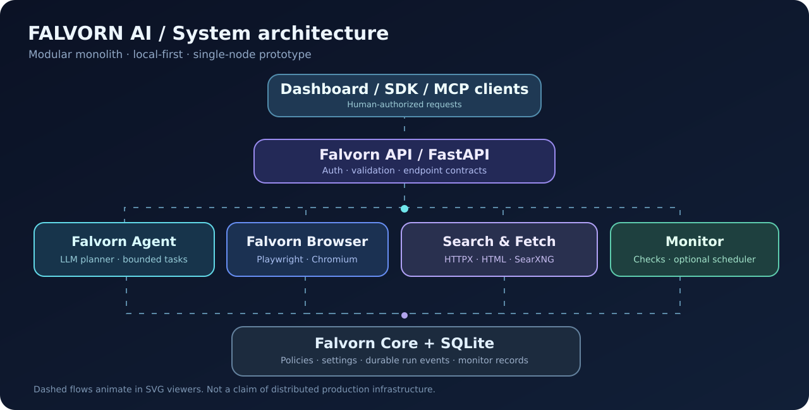
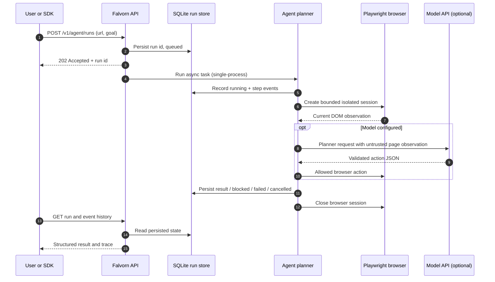

# Falvorn AI — Engineering architecture v0.2

## System boundary

Falvorn AI v0.2 is a **single-process, single-node modular monolith**, not a distributed SaaS. Four conceptual modules correspond to Python files: Agent (`agent.py`), Browser (`browser.py`), API (`api.py`, `sdk.py`, `mcp_server.py`), and Core (`config.py`, `models.py`, `security.py`, `store.py`). The UI is served as local static HTML. SQLite records agent run state and events as well as page-change monitor subscriptions.

### Execution sequence

## Operational model

| Concern | Current implementation | Production requirement |
| --- | --- | --- |
| Browser isolation | One Playwright context per session; in-process Chromium | Dedicated worker containers, strict isolation, egress proxy, quotas |
| Reasoning | Optional OpenAI-compatible API | Evaluation, model routing, cost limits, prompt-injection defense |
| Persistence | SQLite WAL for events and monitor subscriptions | Postgres + durable queue for multi-worker deployment |
| Async work | In-process `asyncio` tasks, cancellable | Multi-process scheduling, distributed locks, drain/reshard handling |
| Monitoring | Manual checks; optional single-process interval scheduler | Dedicated scheduled worker, retries, alert delivery, rate limits |
| Identity | One API key | Tenant isolation, RBAC, SSO, approvals and audit |
| API contract | FastAPI OpenAPI and Python client | Backward compatibility policy, contract tests and versioned SDKs |
| Observability | JSON events exposed by API | Structured metrics, centralized tracing and redaction |

### Trust and safety boundaries

Browser content is untrusted and must not override system/user goals. HTTP navigation is validated against blocked/private targets, but DNS resolution may change after validation: **network-level egress filtering is mandatory before public hosting**. Current sensitive-field and consequential-click restrictions are heuristic and not a complete guarantee. Browser screenshots can contain personal data: access is gated by API auth and must not be logged or redistributed. See [threat model](security/threat-model.md).

### Failure recovery

On application restart, previously `queued`/`running` runs are marked `interrupted`, preserving the event trail without falsely restarting an unknown side-effecting action. Monitor subscriptions persist, but only execute when `MONITOR_SCHEDULER_ENABLED=true` and the one application worker is running. Scaling to multiple workers with this scheduler is unsupported.
