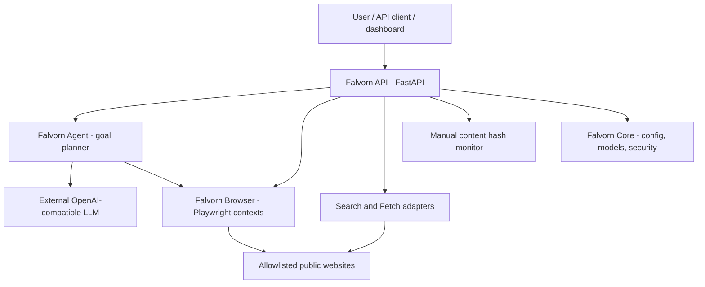
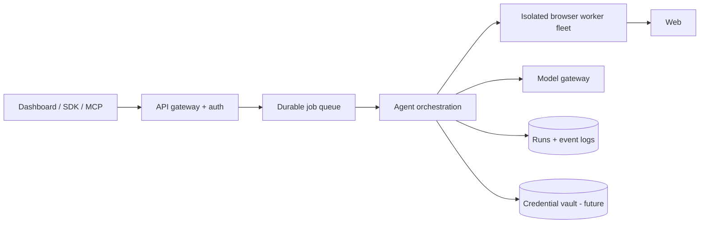

# Falvorn AI architecture

## Current system (v0.1)

This is a **modular monolith**, not four independently deployable services. The four names are product/component boundaries: `falvorn/agent.py`, `falvorn/browser.py`, `falvorn/api.py`, and shared modules (`falvorn/config.py`, `models.py`, `security.py`). Keep them together while contracts and user demand evolve.

## Trust boundaries

1. **User → API:** API key authentication is appropriate only for controlled single-user environments.
2. **API → web targets:** syntax, domain and public-IP checks restrict the most obvious unsafe requests, but network isolation is still missing.
3. **Webpage → reasoning model:** website content is untrusted, may contain prompt injection, and must never override user/task policy.
4. **Model → browser actions:** validate action schema and prohibit default writes and consequential side effects.
5. **Browser → host:** Playwright contexts share infrastructure; harden with separate workers and outbound policies before commercial use.

## Planned deployment structure

This second diagram is a **target architecture**, not currently implemented. For feature availability and benchmarks see [roadmap](roadmap.md) and [PARITY](../PARITY.md).
