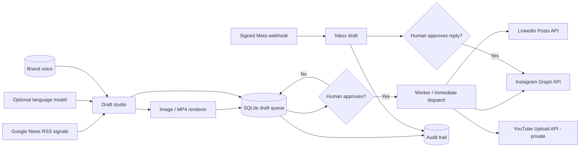

<div align="center">

# ◆ FALVORN / SOCIAL

### The human-governed social media operations agent

**Detect signals · Draft in brand voice · Create media · Approve · Schedule · Publish · Respond**

[](https://python.org) [](https://fastapi.tiangolo.com/)   

**[Quick start](#-quick-start) · [Capabilities](#-real-capabilities-and-boundaries) · [Architecture](#-architecture) · [API](docs/API.md) · [Security](docs/THREAT_MODEL.md)**

</div>

> **Release status: engineering beta, not independently certified production SaaS.** Features below are implemented, with local tests, but external social API integrations require approved credentials and live provider validation. No live accounts were connected during development. Human approval is mandatory. The demonstration referenced by the user is [this Instagram reel](https://www.instagram.com/reel/DeuC1xPzgmQ/); this is an independent implementation, not the author's source code.

## What you get

An **isolated**, self-hostable product under the Falvorn AI umbrella. The responsive interface and REST API run on your own infrastructure; the worker handles approved schedules. There is no mock backend, fake dashboard metrics or silent external posting. Empty data is displayed honestly.

### System overview



### Real capabilities and boundaries

| Domain | Implemented behavior | Boundary / prerequisite |
|---|---|---|
| Industry signals | Fetches source-linked Google News RSS results | News headlines are **not** real-time trend scores; source verification required |
| Brand voice | Persistent brand, audience, forbidden terms | One organization / trusted admin key, not multi-tenant RBAC |
| Copy generation | OpenAI-compatible chat completion; clear template fallback | Model optional, model outputs must be reviewed |
| Image creation | Server-rendered original branded PNG | Template graphics, not text-to-image diffusion |
| Video creation | 6-second vertical MP4 motion built from original art via FFmpeg | Original silent design, not cinematic generative AI video |
| Content approval | Atomically gated `draft → approved` transitions | Cannot publish unapproved drafts |
| Scheduled queue | Durable SQLite queue + independent worker | **One worker only**; no enterprise cluster/failover |
| LinkedIn | Text post through official Posts API | Approved OAuth scopes, token and author URN required |
| Instagram | Image and reel media publishing through Meta Graph API | Professional account + Meta permissions + public HTTPS media required |
| YouTube | Resumable MP4 upload via official API | OAuth upload token; video intentionally **private** after upload |
| Inbox | Signed Meta webhook ingestion, deduplication, editable AI-assisted replies | Only supported message event shapes; permissions and 24-hour window apply |
| Governance | Durable event log, explicit consent and dry-run by default | Not an immutable external audit ledger |
| Test suite | API/approval/scheduler/webhook/media tests | Live third-party publishing has not been executed |

## 🚀 Quick start

**Requirements:** Docker + Compose (recommended), or Python 3.12+, FFmpeg and a system font.

```bash
# From the Falvorn-AI repository root:
cd products/social-orchestrator
cp .env.example .env
python -c "import secrets; print(secrets.token_urlsafe(36))"
# Paste the generated value as SOCIAL_API_KEY in .env, leave SOCIAL_DRY_RUN=true.
docker compose up --build -d
```

Open **http://127.0.0.1:8050** (local loopback only); paste your `SOCIAL_API_KEY` in the top bar. Nothing publishes externally in dry-run mode. Test a post: generate draft → save → approve → publish now. Status becomes `simulated`, not `published`.

**Python development:**

```bash
cd products/social-orchestrator
python -m venv .venv
source .venv/bin/activate
pip install -r requirements-dev.txt
export SOCIAL_API_KEY="$(python -c 'import secrets;print(secrets.token_urlsafe(36))')"
export SOCIAL_DB_PATH="$(pwd)/social.db"
export SOCIAL_MEDIA_DIR="$(pwd)/media"
uvicorn app.main:app --host 127.0.0.1 --port 8050
# In another terminal with the same env: python -m app.worker
pytest -q
```

### Enabling live integrations (deliberate opt-in)

1. Create platform developer applications with the required approvals, scopes and OAuth tokens. **Do not commit tokens**. See [API integration guide](docs/INTEGRATIONS.md).
2. Publish generated media at an HTTPS hostname accessible to Meta. Set `PUBLIC_MEDIA_URL` only when deliberately exposing `/public/media/*`; protect the rest of the API using TLS and a reverse proxy.
3. Confirm owner rights, content policies, real-time platform terms and moderation. Only then set `SOCIAL_DRY_RUN=false`.
4. Test each integration with an account you control and verify the returned remote ID on the provider before scheduling real campaigns. Expired provider tokens need renewing manually in this release.

> The admin API uses a single shared key. **Do not expose the admin API directly to the public Internet.** Deploy behind private network access or stronger authentication. This project does not handle OAuth callback/token refresh workflows or customer billing.

## 🧱 Architecture

```text
products/social-orchestrator/
├── app/
│   ├── config.py        # Env-only credentials and startup validation
│   ├── store.py         # SQLite WAL, audit and atomic state machine
│   ├── services.py      # Official platform APIs, feed, LLM, image and video
│   ├── main.py          # Authenticated REST, dashboard and signed webhook
│   └── worker.py        # Single scheduled publishing worker
├── static/              # Responsive dashboard (no external JS dependencies)
├── tests/               # Offline API and workflow verification
├── docs/                # API, operational constraints, threat model
├── Dockerfile           # Non-root API and worker image
├── docker-compose.yml   # Loopback-bound API + one durable worker
└── .env.example         # Documented, no secrets
```

| Data/state | Location | Security assumption |
|---|---|---|
| Brand profiles | SQLite `brand` | Single trusted operator |
| Drafts, schedules and states | SQLite `posts` | Atomic transition and idempotent claim |
| Inbox + replies | SQLite `inbox` | Sensitive messages require private disk + retention controls |
| Audit events | SQLite `audit` | Local log, not tamper-proof |
| Graphic/video assets | `/data/media` | Private by default; optional public URL |
| Platform API secrets | Environment variables only | Keep credentials in your secrets manager, never DB or Git |

### Release gates

- ✅ Compile and local automated tests.
- ✅ Dry-run approval, job claim and sample PNG generation.
- ✅ Original vertical MP4 rendered and header/file size inspected in local test; repeat on deployment target.
- ⚠️ Browser UI cross-device smoke test is still required on target devices.
- ⛔ Live Instagram, LinkedIn, YouTube and DM API calls **not verified** without a connected test account.
- ⛔ Multi-tenant production SaaS, worker fleet, OAuth refresh vault, billing, guaranteed delivery and security audit **not implemented**.

Full gates and hardening priorities: [Threat model](docs/THREAT_MODEL.md).

## Ownership, provenance and conduct

© 2026 **Md Najmul Hossain**. Proprietary, all rights reserved under the [Falvorn AI repository license](../../LICENSE); third-party library licenses remain independent. This is not affiliated with Instagram, Meta, LinkedIn, YouTube, Google or the reel creator. Respect users' privacy, platform policies, approved scopes, opt-in and message window rules. No cookie scraping, password collection or rate-limit evasion.
